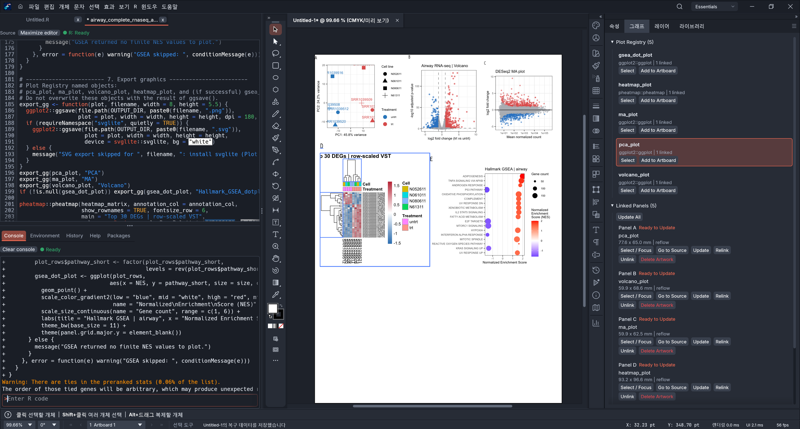
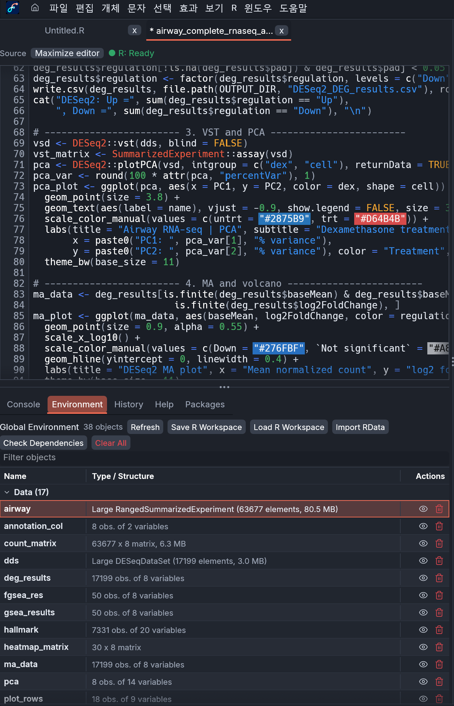
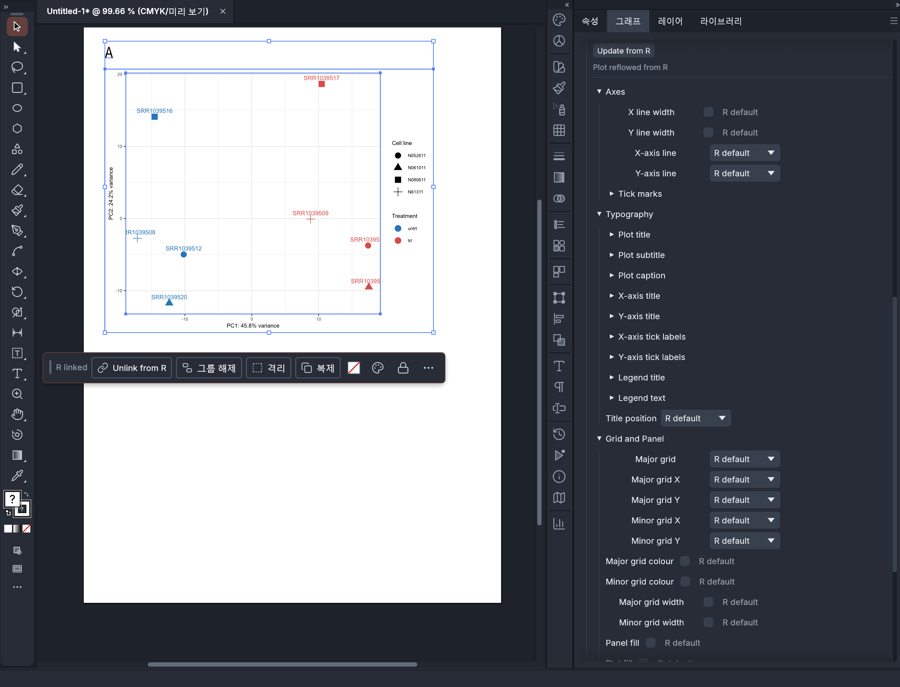

# FigureIDE

<!-- This README is a modified derivative of the VectorCraft project documentation. -->

> FigureIDE is an independently modified derivative of VectorCraft. See [License and attribution](#license-and-attribution).

<p align="center"></p>

**FigureIDE** is a scientific vector-figure editor built with Rust and egui. It combines an R coding workspace with editable vector artwork so researchers can compose, preserve and export publication figures.

> **Status:** Pre-release / beta candidate. The native Linux x86_64 build and core R/figure workflow have been exercised on Ubuntu 26.04 under XFCE/XRDP with software rendering. Linux remains experimental: Wayland, hardware acceleration, and a complete native desktop-install path have not been validated. Windows binaries and the complete R workflow must pass release checks before being considered validated.

## Features

- **R Source Editor and Console:** edit scripts, execute code in a persistent R session and inspect the Environment.
- **Plot Registry and Graph Inspector:** manage ggplot-derived plots, sizes, styles and linked R variables.
- **Linked scientific plots:** preserve R object associations while using a fast preview for interaction; reflow from R when needed.
- **Native vector editing:** annotate figures and arrange panels using document/vector tools.
- **Folder-based projects:** keep scripts, individual `.fide` figures and project metadata together.
- **Optional R workspace snapshots:** save `.GlobalEnv` into `workspace/workspace.RData` and explicitly load it later.
- **SVG/PDF exports:** aimed at publication workflows; verify final artwork in your target journal/export viewer.

## Project layout

```text
MyAnalysis/
├── project.json
├── scripts/
│   └── analysis.R
├── figures/
│   └── Figure_01.fide
├── workspace/
│   └── workspace.RData   # only when requested
└── assets/
```

A **project** is a directory; an individual editable **figure** is a `.fide` file. Opening a project does not automatically load saved R variables or rerun scripts.

## Install (Windows)

1. Open [Releases](https://github.com/newkor3185-blip/FigureIDE/releases) and download a Windows x64 portable ZIP **when a verified release is available**.
2. Extract it to a local folder and start `FigureIDE.exe`.
3. R is optional. Install it separately only if you want to run analysis scripts, manage an R workspace, or re-render R-linked figures. Vector editing, saving `.fide` files, and ordinary SVG/PDF export work without R.

R and user-installed R packages are **not bundled** with the portable ZIP. Saved figure artwork can be viewed without rerunning analyses, but R-linked reflow requires a compatible R environment.

### Optional R setup on Windows

1. Install the current Windows build of [R from CRAN](https://cran.r-project.org/bin/windows/base/). In the installer, keep the option to add R to `PATH` enabled, or add the installed R `bin` folder to `PATH` yourself.
2. Open R or RStudio and install the packages used by FigureIDE's linked-plot features:

   ```r
   install.packages(c("ggplot2", "svglite", "systemfonts"), repos = "https://cloud.r-project.org")
   ```

   Alternatively, in PowerShell after installing R:

   ```powershell
   Rscript -e 'install.packages(c("ggplot2", "svglite", "systemfonts"), repos = "https://cloud.r-project.org")'
   ```

3. Restart FigureIDE after installing R or changing `PATH`. If R is unavailable, R-specific actions report that R must be installed; the editor and regular vector file operations remain available.

## Linux development build and portable package

Linux x86_64 is experimental. The native release build, FigureIDE window, canvas, menus, toolbar,
source editor, external R session, linked ggplot panel, `.fide` save/reopen, and SVG/PDF export were
tested on Ubuntu 26.04 LTS in XFCE over XRDP. XRDP selected Mesa llvmpipe software rendering; this
does not validate GPU acceleration. See [Linux validation and limitations](docs/figureide-linux.md)
for the exact checks and outstanding items.

The manually run [FigureIDE Linux workflow](.github/workflows/figureide-linux-release.yml) builds a
portable archive as a GitHub Actions artifact. It does not publish a GitHub Release. To build locally
on Ubuntu or a compatible x86_64 Linux system, install the compiler and native development headers:

```sh
sudo apt update
sudo apt install build-essential pkg-config libxkbcommon-dev libxkbcommon-x11-0 libxcb-xkb1 \
  libwayland-dev libx11-dev libxcb1-dev libxcursor-dev libxrandr-dev libxi-dev \
  libfontconfig1-dev libfreetype-dev libgl1-mesa-dev
git clone https://github.com/newkor3185-blip/FigureIDE.git
cd FigureIDE
cargo build --locked --release -p vectorcraft
```

To create the portable archive after building and generating `target/THIRD-PARTY-LICENSES.md` with
`cargo about`, run `packaging/figureide-linux/package.sh`. It writes
`dist/FigureIDE-Linux-x86_64.tar.gz`. Extract the archive and run `./FigureIDE` from its directory.
The archive includes project and dependency license notices. It does not bundle R or Linux system
libraries.

The Linux desktop needs X11 or Wayland runtime libraries, Vulkan or OpenGL/Mesa, fontconfig, and
FreeType. Debian/Ubuntu X11 runtime packages include `libx11-6`, `libxcb1`, `libxcb-xkb1`,
`libxkbcommon0`, `libxkbcommon-x11-0`, `libxcursor1`, `libxrandr2`, and `libxi6`; Vulkan software
rendering is available with `mesa-vulkan-drivers`. Desktop file picking uses an XDG Desktop Portal
provider when available and may fall back to `zenity`.

R remains an optional external dependency. Install R separately and ensure `Rscript` is on `PATH`.
For the tested ggplot workflow, install packages in R:

```r
install.packages(c("ggplot2", "svglite", "systemfonts"), repos = "https://cloud.r-project.org")
```

Without R, vector editing, `.fide` saving/reopening, and ordinary SVG/PDF export remain available;
R scripts and linked-plot refresh require R and the relevant R packages.

## Build from source

Requirements: Rust toolchain and Git. R is optional for R-specific functionality.

```sh
git clone https://github.com/newkor3185-blip/FigureIDE.git
cd FigureIDE
cargo build --locked --release -p vectorcraft
```

On Windows, run `target\release\vectorcraft.exe`. On Linux, run
`target/release/vectorcraft` from a graphical desktop session. The executable target and some
internal crate names retain the upstream `vectorcraft` identifier for compatibility; distributed
builds use the FigureIDE name.

Check R on Linux or Windows with:

```sh
Rscript --version
```

In R:

```r
install.packages(c("ggplot2", "svglite"))
```

Some workflows, such as the RNA-seq example below, require additional CRAN/Bioconductor packages.

## FigureIDE screenshots

These screenshots show FigureIDE running with an R analysis, editable vector artwork, and linked-plot controls.

<p align="center">
  
</p>

<table>
  <tr>
    <td align="center"></td>
    <td align="center"></td>
  </tr>
  <tr>
    <td align="center"><em>Write and run R analysis scripts, then inspect workspace objects.</em></td>
    <td align="center"><em>Inspect and adjust a selected R-linked plot in the vector editor.</em></td>
  </tr>
</table>

For actual scientific output examples, see the [airway RNA-seq example](examples/airway/), including exported PCA, MA and volcano plots.

## Example: airway RNA-seq

The `examples/airway/` directory contains an R analysis script and generated example results based on the public Bioconductor `airway` dataset. The `.RData` snapshot is an R serialized object file and should be inspected before redistributing or executing it in an R session.

The original script produces output under `airway_analysis_results/` relative to the R working directory; adjust `OUTPUT_DIR` for your environment.

## Development and release verification

The Windows packaging workflow is [FigureIDE Windows Release](.github/workflows/rvs-windows-release.yml); Linux packaging is the manual [FigureIDE Linux workflow](.github/workflows/figureide-linux-release.yml). A passing YAML lint alone does **not** establish a successful executable build, install experience or figure round trip.

Before publishing a beta, verify: project creation → script editing → figure save → optional R workspace save → app exit → project reopen → explicit workspace load → linked plot Reflow → SVG/PDF export.

Report bugs via [GitHub Issues](https://github.com/newkor3185-blip/FigureIDE/issues).

## License and attribution

FigureIDE is a modified derivative of the [VectorCraft project](https://github.com/storytold/vectorcraft), created by the ArtCraft team and VectorCraft contributors. VectorCraft copyright and attribution notices are retained. FigureIDE's source is offered under the MIT License or Apache License 2.0, at your option; see [LICENSE-MIT](LICENSE-MIT), [LICENSE-APACHE](LICENSE-APACHE), and [NOTICE](NOTICE). Third-party dependencies and bundled assets remain under their own licenses, listed in [ASSETS.md](ASSETS.md).

The ArtCraft name and logos are trademarks and are not covered by the source license. FigureIDE is an independent modified project; its name, supplied FigureIDE artwork, and distribution do not imply that ArtCraft sponsors or endorses it. Windows portable ZIPs include both project licenses, attribution notices, the dependency license report, and the bundled asset license texts.

Apache-2.0 Section 4(b) separately requires prominent notices in modified files when redistributing under that license; a top-level `NOTICE` does not replace that file-level condition. Preserve upstream copyright notices and check file-level change notices when modifying VectorCraft-derived source.

## Links

- [Source repository](https://github.com/newkor3185-blip/FigureIDE)
- [Releases](https://github.com/newkor3185-blip/FigureIDE/releases)
- [Issues](https://github.com/newkor3185-blip/FigureIDE/issues)
- [Development documentation](docs/development.md)
