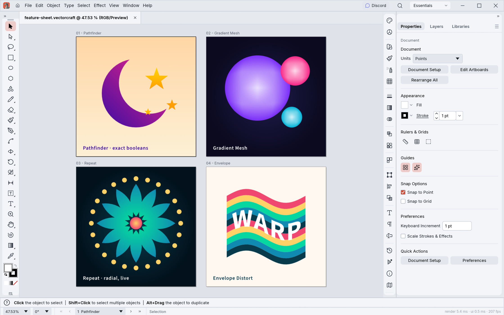

# FigureIDE

<p align="center"></p>

**FigureIDE** is a Windows-first scientific vector-figure editor built with Rust and egui. It combines an R coding workspace with editable vector artwork so researchers can compose, preserve and export publication figures.

> **Status:** Pre-release / beta candidate. Windows binaries and the complete R workflow must pass release checks before being considered validated.

## Features

- **R Source Editor and Console:** edit scripts, execute code in a persistent R session and inspect the Environment.
- **Plot Registry and Graph Inspector:** manage ggplot-derived plots, sizes, styles and linked R variables.
- **Linked scientific plots:** preserve R object associations while using a fast preview for interaction; reflow from R when needed.
- **Native vector editing:** annotate figures and arrange panels using document/vector tools.
- **Folder-based projects:** keep scripts, individual `.fide` figures and project metadata together.
- **Optional R workspace snapshots:** save `.GlobalEnv` into `workspace/workspace.RData` and explicitly load it later.
- **SVG/PDF exports:** aimed at publication workflows; verify final artwork in your target journal/export viewer.

## Project layout

```text
MyAnalysis/
├── project.json
├── scripts/
│   └── analysis.R
├── figures/
│   └── Figure_01.fide
├── workspace/
│   └── workspace.RData   # only when requested
└── assets/
```

A **project** is a directory; an individual editable **figure** is a `.fide` file. Opening a project does not automatically load saved R variables or rerun scripts.

## Install (Windows)

1. Open [Releases](https://github.com/newkor3185-blip/FigureIDE/releases) and download a Windows x64 portable ZIP **when a verified release is available**.
2. Extract it to a local folder and start `FigureIDE.exe`.
3. To run R code and update linked figures, install [R](https://cran.r-project.org/) and the R packages required by your scripts, notably `ggplot2` and `svglite`.

R and user-installed R packages are **not bundled** with the portable ZIP. Saved figure artwork can be viewed without rerunning analyses, but R-linked reflow requires a compatible R environment.

## Build from source

Requirements: Rust toolchain, Git and R for R-specific functionality.

```powershell
git clone https://github.com/newkor3185-blip/FigureIDE.git
cd FigureIDE
cargo build --locked --release -p vectorcraft
.\target\release\vectorcraft.exe
```

The executable target and some internal crate names retain the upstream `vectorcraft` identifier for compatibility; distributed builds use the FigureIDE name.

To check your R setup:

```powershell
Rscript --version
```

In R:

```r
install.packages(c("ggplot2", "svglite"))
```

Some workflows, such as the RNA-seq example below, require additional CRAN/Bioconductor packages.

## Screenshots and visual references

The following are **upstream vector-editor reference images**, not screenshots of the latest FigureIDE R workspace. Current FigureIDE UI screenshots will be added after Windows release verification.

| Vector editing reference | Artwork reference |
| --- | --- |
|  |  |

For actual scientific output examples, see the [airway RNA-seq example](examples/airway/), including exported PCA, MA and volcano plots.

## Example: airway RNA-seq

The `examples/airway/` directory contains an R analysis script and generated example results based on the public Bioconductor `airway` dataset. The `.RData` snapshot is an R serialized object file and should be inspected before redistributing or executing it in an R session.

The original script produces output under `airway_analysis_results/` relative to the R working directory; adjust `OUTPUT_DIR` for your environment.

## Development and release verification

The Windows packaging workflow is [FigureIDE Windows Release](.github/workflows/rvs-windows-release.yml). A passing YAML lint alone does **not** establish a successful Windows executable build, install experience or figure round trip.

Before publishing a beta, verify: project creation → script editing → figure save → optional R workspace save → app exit → project reopen → explicit workspace load → linked plot Reflow → SVG/PDF export.

Report bugs via [GitHub Issues](https://github.com/newkor3185-blip/FigureIDE/issues).

## License and attribution

FigureIDE builds on the VectorCraft codebase. The repository retains upstream copyright notices and third-party licenses. See [LICENSE-MIT](LICENSE-MIT), [LICENSE-APACHE](LICENSE-APACHE) and [NOTICE](NOTICE); some bundled artwork and brand assets have their own terms.

## Links

- [Source repository](https://github.com/newkor3185-blip/FigureIDE)
- [Releases](https://github.com/newkor3185-blip/FigureIDE/releases)
- [Issues](https://github.com/newkor3185-blip/FigureIDE/issues)
- [Development documentation](docs/development.md)
